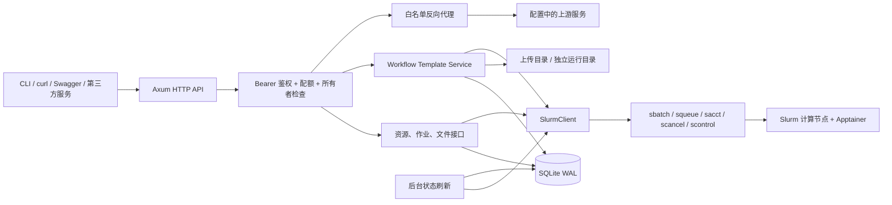

# HPC REST Gateway + Workflow Template Service

本项目独立运行，以 Rust、Axum、Tokio、Serde、SQLite 和 Slurm 命令行完成项目验收。第一版交付 HTTP 后端、Swagger、两份流程模板、JSON 验证报告、自动测试和压测脚本。主线是“模板展开为一个 Slurm 批处理脚本”，流程步骤按顺序执行，不引入 DAG 调度器、消息队列或复杂前端。

完整接口及逐项请求/响应见 [api-examples.md](api-examples.md)；机器可读契约见 [../openapi.json](../openapi.json)。

## 1. 软件架构



一次运行的路径为：上传 FASTQ → 选择模板和参数 → 部署预检查 → 创建不可变快照和运行目录 → 生成 `job.sbatch` → 显式执行 → `sbatch --parsable` → 后台刷新状态 → 查看日志/结果 → 生成 JSON 验证报告。部署不提交作业，返回 `DEPLOYED` 后再执行。

`mock_slurm=true` 用于本地 API 联调和可重复功能测试，生成模拟结果；真实集群验收必须切换为 `false`，安装 Slurm CLI，并配置真实镜像、参考数据和已验证的小样本。模拟 VCF 不能证明生物学分析准确。

## 2. REST API 完整列表

除健康检查、OpenAPI、Swagger 外，所有接口要求 `Authorization: Bearer <token>`。普通用户仅访问自己创建的作业、文件、运行；管理员可访问全部。

| 方法 | 路径 | 用途 | 额外权限 |
|---|---|---|---|
| GET | `/healthz` | 进程存活 | 公开 |
| GET | `/readyz` | 服务就绪 | 公开 |
| GET | `/api-docs/openapi.json` | OpenAPI 文档 | 公开 |
| GET | `/swagger-ui/` | Swagger UI | 公开 |
| GET | `/api/v1/clusters` | 配置中的集群列表 | 登录 |
| GET | `/api/v1/applications` | 应用及绑定集群 | 登录 |
| GET | `/api/v1/applications/{id}/queues` | 应用允许的队列 | 登录 |
| PUT | `/api/v1/applications/{id}/cluster` | 设置应用默认集群 | 管理员 |
| GET / POST / PUT / PATCH / DELETE | `/api/v1/gateway/{service}/{path}` | 转发到固定上游服务，保留 query | 登录 |
| POST | `/api/v1/jobs` | 提交可信批处理脚本 | 管理员 |
| GET | `/api/v1/jobs` | 查询本地已登记作业 | 登录 |
| GET | `/api/v1/jobs/{id}` | 查询一个作业 | 所有者/管理员 |
| PATCH | `/api/v1/jobs/{id}/state` | cancel / hold / release | 所有者/管理员 |
| POST | `/api/v1/files` | multipart 上传单个文件 | 登录 |
| GET | `/api/v1/files` | 列出文件元数据 | 登录 |
| GET | `/api/v1/files/{id}` | 查询文件元数据 | 所有者/管理员 |
| GET | `/api/v1/files/{id}/content` | 查看最多 64 KiB 内容 | 所有者/管理员 |
| GET | `/api/v1/files/{id}/download` | 下载文件 | 所有者/管理员 |
| GET | `/api/v1/workflows` | 查询模板 | 登录 |
| GET | `/api/v1/workflows/{id}` | 查询当前模板 | 登录 |
| PUT | `/api/v1/workflows/{id}` | 新增模板版本 | 管理员 |
| POST | `/api/v1/workflows/{id}/deploy` | 检查并部署一次运行 | 登录 |
| GET | `/api/v1/runs` | 查询运行记录 | 登录 |
| GET | `/api/v1/runs/{id}` | 查看运行快照、状态和时间 | 所有者/管理员 |
| POST | `/api/v1/runs/{id}/execute` | 提交已部署运行 | 所有者/管理员 |
| GET | `/api/v1/runs/{id}/logs` | 分段读取日志 | 所有者/管理员 |
| GET | `/api/v1/runs/{id}/results` | 查询声明的输出及存在性 | 所有者/管理员 |
| POST | `/api/v1/runs/{id}/validate` | 执行功能验证，保存 JSON 报告 | 所有者/管理员 |
| GET | `/api/v1/runs/{id}/report` | 读取已生成报告 | 所有者/管理员 |

列表返回数组，详情返回对象。业务错误为 `{"error":{"code":"not_found","message":"..."}}`；使用 400、401、403、404、409、413、429、502 等状态表达输入、权限、冲突、容量和上游问题。Axum extractor 对 JSON/Query 语法错误及 body 限制的拒绝可能使用原生文本响应，客户端应先看 HTTP 状态与 Content-Type。

## 3. Rust 项目结构与第一版文件

```text
hpc-gateway/
├── Cargo.toml
├── config.example.json
├── openapi.json
├── migrations/001_init.sql
├── src/
│   ├── main.rs        # 配置、日志、启动与退出
│   ├── lib.rs         # AppState、路由装配、后台任务
│   ├── config.rs      # JSON 配置、集群/应用/上游白名单
│   ├── error.rs       # HTTP 错误契约
│   ├── db.rs          # SQLite 初始化、JSON 记录读写
│   ├── auth.rs        # API Key、角色、令牌桶、异步审计
│   ├── api.rs         # 各 REST handler 与对象访问控制
│   ├── slurm.rs       # 真实 CLI / mock 后端
│   └── workflow.rs    # 模板解析、参数校验、部署、脚本、报告
├── workflows/
│   ├── germline.yaml
│   ├── somatic.yaml
│   └── schema.json
├── scripts/
│   ├── load.js
│   └── smoke.py
├── tests/
└── docs/
    ├── architecture.md
    └── api-examples.md
```

第一版把 handlers 放在一个 `api.rs`，避免为每个实体增加 repository/service/controller 三层。规模增长后再按 `api/{jobs,files,resources,workflows,runs,gateway}.rs` 拆分；领域模型保持在实际使用模块中。

## 4. 数据模型

| 模型 | 关键字段 | 约束/用途 |
|---|---|---|
| Principal | subject、admin | key 对应稳定身份；同一 subject 的 key 共用所有权和配额 |
| Cluster | id、name、partitions | 第一版使用受控配置登记集群及队列 |
| Application | id、name、cluster_id、partitions | 绑定默认集群，提交时检查集群/应用组合 |
| Job | id、owner、slurm_id、application_id、cluster_id、name、state、创建/更新时间 | HTTP ID 为 UUID，Slurm ID 单独保存 |
| FileRecord | id、owner、filename、path、size、created_at | 物理文件以服务器生成 ID 命名，原文件名仅作元数据 |
| WorkflowTemplate | id、version、application、image、references、inputs、parameters、resources、steps、outputs | 管理员编写，版本不可覆盖 |
| Run | id、owner、template 快照、inputs、parameters、deployment、cluster_id、run_dir、state、job_id、时间 | deployment.snapshot.parameters 保存已应用默认值的参数；后续编辑不改变已有运行 |
| ValidationReport | run_id、workflow、版本、状态、检查项、结果、时间、模拟标志 | 功能、文件结构与执行结果验证 |
| Audit | owner、method、path、status、created_at | 异步写入；队列饱和记录警告，不保存 token/文件内容 |

SQLite 存元数据，FASTQ、BAM、VCF、日志和模板快照存文件系统。输入 API 接收上传后的文件 UUID，不接受普通用户填写服务器任意路径。镜像和参考路径来自管理员模板。

运行状态主线为 `DEPLOYED → SUBMITTING → PENDING → RUNNING → COMPLETED/FAILED/CANCELLED`；提交结果不确定时保留 `SUBMISSION_UNKNOWN`。Slurm 状态来自实际命令结果，验证报告另外标记是否通过。查询返回最近一次同步结果，默认刷新周期 2 秒；短时会有最终一致性延迟。

## 5. SQLite 表结构

以下与 `migrations/001_init.sql` 一致。模板、配置和请求采用 Rust 类型校验；作业、文件、运行记录以 JSON 保存，减少迁移和重复映射代码，需要复杂查询时再提升具体列。

```sql
PRAGMA journal_mode = WAL;
PRAGMA foreign_keys = ON;
CREATE TABLE IF NOT EXISTS jobs (
  id TEXT PRIMARY KEY, owner TEXT NOT NULL,
  data TEXT NOT NULL CHECK(json_valid(data)), updated_at TEXT NOT NULL
);
CREATE INDEX IF NOT EXISTS jobs_owner ON jobs(owner);
CREATE TABLE IF NOT EXISTS runs (
  id TEXT PRIMARY KEY, owner TEXT NOT NULL,
  data TEXT NOT NULL CHECK(json_valid(data)), updated_at TEXT NOT NULL
);
CREATE INDEX IF NOT EXISTS runs_owner ON runs(owner);
CREATE TABLE IF NOT EXISTS files (
  id TEXT PRIMARY KEY, owner TEXT NOT NULL,
  data TEXT NOT NULL CHECK(json_valid(data)), updated_at TEXT NOT NULL
);
CREATE INDEX IF NOT EXISTS files_owner ON files(owner);
CREATE TABLE IF NOT EXISTS workflow_versions (
  id TEXT NOT NULL, version TEXT NOT NULL, yaml TEXT NOT NULL,
  created_at TEXT NOT NULL, PRIMARY KEY(id, version)
);
CREATE TABLE IF NOT EXISTS audit_logs (
  id INTEGER PRIMARY KEY AUTOINCREMENT, owner TEXT NOT NULL,
  method TEXT NOT NULL, path TEXT NOT NULL, status INTEGER NOT NULL,
  created_at TEXT NOT NULL
);
CREATE INDEX IF NOT EXISTS audit_created ON audit_logs(created_at);
CREATE TABLE IF NOT EXISTS app_bindings (
  application_id TEXT PRIMARY KEY, cluster_id TEXT NOT NULL
);
```

WAL 允许读取与写入更好地并行，SQLite 仍然是单写者；元数据数据库应放本机磁盘，避免把 WAL 数据库放入集群共享 NFS。配置 `database_path` 为可选路径，默认 `null` 使用 `data_dir/gateway.sqlite3`；真实 Slurm 部署把 `data_dir` 指向共享数据盘，把 `database_path` 明确设置到本机磁盘。共享计算节点只访问上传、运行和参考数据目录。[SQLite 官方 WAL 文档](https://sqlite.org/wal.html)

```json
{
  "data_dir": "/shared/hpc-gateway/data",
  "database_path": "/var/lib/hpc-gateway/gateway.sqlite3",
  "mock_slurm": false
}
```

上面是合并到 `config.example.json` 的配置片段。`local` 是开发示例集群名；真实环境中的集群 ID 必须对应当前服务账户可用的 Slurm cluster 名称，第一版直接把 ID 传给 Slurm `--clusters`。

## 6. Slurm Client 封装

HTTP 层只传递校验后的应用、集群、脚本路径和 Slurm ID，不直接拼接 shell。使用 `tokio::process::Command` 的独立 `.arg()`；只有管理员模板生成的批处理脚本由 Slurm 的 shell 执行。

| 封装方法 | 命令 | 返回/处理 |
|---|---|---|
| submit | `sbatch --parsable --clusters <cluster> <job.sbatch>` | 解析 `jobid` 或 `jobid;cluster`；模板脚本声明运行目录 |
| query active | `squeue ... --noheader --format=...` | 解析活动作业状态 |
| query history | `sacct ... --parsable2 --noheader --format=...` | 作业离开队列后查终态、退出码和时间 |
| cancel | `scancel --clusters <cluster> <jobid>` | 命令成功后记录 CANCELLED；真实验收用 sacct 对照 |
| hold | `scontrol hold <jobid>` | 仅对允许的动作调用 |
| release | `scontrol release <jobid>` | 成功不代表立刻获得资源 |

默认命令超时 15 秒、并发上限 8，超时终止子进程。GET 作业接口读取 SQLite 缓存，不为每次请求执行 Slurm；后台按活动作业逐一刷新，受同一并发信号量限制，避免 100 QPS 转化为 100 次/s `squeue`。后续作业规模增长后可以按集群批量查询。命令输出采用 Slurm 固定字段，第一版尚未为命令输出实现字节上限。

提交前先登记 `SUBMITTING`，命令报错/超时记录 `SUBMISSION_UNKNOWN`，因为 controller 可能已经接收提交；进程重启也会把未完成的提交标记为待人工核对，禁止自动重提。201/202 表示本地记录/提交动作已受理，最终应检查返回状态和 Slurm ID。`squeue` 查不到不能当成功，必须再查 `sacct`，会计延迟期间保持 `UNKNOWN`。

`sbatch` 接收脚本后即返回作业 ID，作业可能仍在等待资源；Slurm 不自动搬运脚本以外的数据，因此上传目录、参考目录、运行目录必须对执行节点可见。[Slurm sbatch 文档](https://slurm.schedmd.com/sbatch.html) [Slurm squeue 文档](https://slurm.schedmd.com/squeue.html)

## 7. Workflow YAML Schema 与两个流程

可执行模板见 [germline.yaml](../workflows/germline.yaml)、[somatic.yaml](../workflows/somatic.yaml)，JSON Schema 见 [schema.json](../workflows/schema.json)。YAML 解析为 Serde 强类型结构并拒绝未知字段；部署还校验参数类型、取值范围、必需输入、文件归属和资源约束。Schema 用于编辑器/离线校验，Rust 校验是运行时边界。

| YAML 字段 | 类型及约束 |
|---|---|
| id / name / version / application | 必需字符串；id、version、application 为受限标识符；application 必须已登记 |
| description | 可选字符串 |
| image | 必需，本地 SIF 镜像路径 |
| references | 名称 → 文件路径，模板显式列出 FASTA 和全部所需索引 |
| inputs | 名称 → `{kind: fastq 或 file, required: true, description: 字符串}`；MVP 仅支持必需输入 |
| parameters | 名称 → `{type, default, minimum?, maximum?, allowed_values?, format?, description?}`；type 为 string/integer/number/boolean；format 可为 sample_id |
| resources | `{cpus, memory_gb, time_minutes}`；cpus 1–128，内存 1–1024 GiB，时间 1–10080 分钟 |
| steps | 有序 `{id, command}` 数组；每步在同一运行目录执行，失败即停止 |
| outputs | 名称 → `{path, kind, required}`；path 是运行目录内相对路径，kind 为 vcf/file |

占位符为 `{{input:reads_r1}}`、`{{param:threads}}`、`{{reference:fasta}}`、`{{output:variants}}`、`{{run_dir}}`；渲染器把每个参数作为单个 POSIX shell 参数引用，并拒绝未知/未闭合占位符。模板中的 command 属于管理员代码；普通用户仅能编辑已声明参数。完整且可加载的两个 YAML 就在仓库中，不需要根据伪代码自行补全。

| 流程 | 输入 | 完整处理路径 | 定制参数 |
|---|---|---|---|
| Germline variant calling | 一对样本 FASTQ | 输入检查 → BWA 比对/SAMtools 排序 → 重复标记 → BQSR → HaplotypeCaller → 基本过滤 → VCF 检查/报告 | sample_id、threads、memory_gb、time_minutes |
| Somatic variant calling | tumor 和 normal 各一对 FASTQ | 输入检查 → 双样本比对/排序 → 重复标记/BQSR → Mutect2 → 方向偏差建模 → FilterMutectCalls → VCF 检查/报告 | tumor_sample、normal_sample、threads、memory_gb、time_minutes |

用户已确认本次“基因组测序信号识别全流程”的验收边界为 **FASTQ → 比对 → 变异检测 → 验证报告**。两模板按这一边界交付；原始电流/POD5/FAST5 的 basecalling 不属于本次范围。

部署明确执行五步：①检查本地 Apptainer SIF 路径是非空普通文件；②检查模板列出的参考文件及所需索引为非空文件；③检查所有输入 UUID、所有权、文件存在和参数；④创建独立运行目录并保存输入/模板/完整参数快照；⑤生成 Slurm 脚本。第一版不执行 `apptainer inspect`，不在部署时运行工具版本探测；输入检查也不解析整个 FASTQ。模板已有 FASTA、FAI、DICT、BWA 和已知位点相关索引清单。真实运行依赖包含 BWA、SAMtools、GATK 的镜像及匹配的参考/已知位点数据。真实 Slurm 部署使用 Linux 无空格的数据路径，Windows 用于 mock 开发。

## 8. 鉴权、访问控制和代理边界

MVP 使用高熵 Bearer API Key；配置存 SHA-256 摘要，环境变量 `HPC_API_TOKEN` 可提供至少 16 字符的本地管理员 token，其身份为 `local-admin`。生产环境由管理员分发随机 token，使用 HTTPS 反向代理，不把 token 写入 URL、日志或 Swagger 默认值。撤销/轮换通过更新配置后重启实现。

管理员可修改应用绑定、新建模板版本、直接提交 Slurm 脚本。普通用户可部署管理员审核过的模板，读取/下载自己的文件和运行，并控制自己的作业。每个详情、日志、下载、执行和验证入口都做所有权检查；不能只在列表中过滤。

代理只允许配置中 `upstreams` 的 service ID，固定 scheme/host/base path，支持 GET/POST/PUT/PATCH/DELETE，保留 query。用户不能提供任意上游 URL；不跟随重定向，不转发 Gateway Bearer 凭据、Cookie、Host 及 hop-by-hop headers。请求体限制 1 MiB；文件上传走专用接口，默认最大 64 MiB，可配置。代理返回上游的状态与内容。

第一版多个 API 身份共享一个服务 Unix/Slurm 账户，API 所有权不构成计算节点 POSIX 隔离。管理员脚本可在该系统账户权限下执行，因此仅向可信服务账户开放；跨租户生产环境需增加独立 Unix 身份、Slurm account/QOS、目录权限或独立实例。

## 9. 限流和 100 QPS 压测

内存令牌桶按稳定 subject 限制 200 请求/s、突发 400；实例全局 1000 请求/s、突发 2000。超限返回 `429` 和 `Retry-After: 1`。默认单实例部署，重启会重置桶；多实例时要改为统一网关配额或共享存储。Slurm 命令另有限流信号量，业务 HTTP 配额与命令并发分开。

`scripts/load.js` 使用 k6 `constant-arrival-rate`，默认持续 10 分钟，以 **110 个每秒到达的迭代，每次仅一个业务 GET**，混合请求集群、应用、模板、作业、文件、运行等鉴权接口，并要求成功业务响应吞吐 ≥100/s。110/s 为 k6 setup/收尾时长和短暂波动留出余量；也可设置 `RATE=100` 精确观察到达率，但最终必须以成功响应数验证指标。登录、限流、序列化、SQLite 查询和异步审计均包含在被测路径内。就绪检查只在 setup 调用，不计入 business 计数。

```sh
k6 run -e BASE_URL=http://127.0.0.1:8080 -e API_TOKEN="$HPC_API_TOKEN" \
  -e RATE=110 -e DURATION=10m --summary-export=benchmark-summary.json scripts/load.js
```

通过标准：无丢弃迭代，业务请求失败率 <1%，p95 <200 ms，p99 <500 ms，并确认 k6 实际业务成功响应吞吐至少 100 次/s。记录服务端 CPU/内存/磁盘、Rust release 构建、CPU 核数、Slurm/mock 模式、配置和数据量；压测端尽量另机以减少资源竞争。100 QPS 是待测目标，不是仅凭框架或单元测试得出的结论。固定到达率模型和阈值用法以 [k6 官方 executor 文档](https://grafana.com/docs/k6/latest/using-k6/scenarios/executors/constant-arrival-rate/) 与 [阈值文档](https://grafana.com/docs/k6/latest/using-k6/thresholds/) 为依据。

本脚本证明元数据查询 API 吞吐。原始作业提交要另做有限并发测试，Slurm 控制器限制决定其速率；不能把 100 QPS 查询结果解释为 100 个作业/s。文件上传下载另测带宽、文件大小和并发。真实上游转发必须配独立可控上游，并单独记录上游耗时。

## 10. OpenAPI / Swagger

`openapi.json` 使用 OpenAPI 3.0.3，包含全部公开/受保护路由、五种转发方法、Bearer security scheme、模型、错误、状态码和示例。服务以 `/api-docs/openapi.json` 返回静态 JSON，通过 vendored `utoipa-swagger-ui` 提供离线可用的 `/swagger-ui/`。静态规范减少 derive 宏与 handler 耦合；修改 API 必须同时修改该文件和请求示例。Rust HTTP 集成测试校验关键路由，另校验 OpenAPI JSON 可解析与所有声明路径存在。

Axum Router、extractor 和 middleware 可直接组成这一后端，不需要另写 HTTP 服务器或控制器框架。[Axum 官方 API 文档](https://docs.rs/axum/latest/axum/)

## 11. 验证报告

每次验证保存 JSON，至少报告：run ID、模板 ID/版本、用户参数及已应用默认值的 resolved_parameters、Slurm 状态、起止时间/耗时、每个必需输出存在性/大小/SHA-256、VCF 基本结构、通过/失败原因以及 `simulated` 标志。通过要求作业 `COMPLETED`、退出码 `0:0` 和所有必需输出检查通过。失败报告也保留，方便考核追溯。

MVP 验证是执行与输出有效性验证。若要证明变异识别准确率，应固定参考版本、工具/镜像摘要和 truth VCF/高置信 BED，用专用评估工具计算 TP、FP、FN、precision、recall、F1；本版不从“存在 VCF”推导这些指标，也不生成虚构数值。小规模真实基准结果可以作为独立附件接入报告。

## 12. MVP 分阶段实现计划

| 阶段 | 交付物 | 完成条件 |
|---|---|---|
| P0：可启动骨架 | Cargo、配置、Axum、SQLite、鉴权、错误、Swagger | release 可构建；无 token 拒绝启动；健康检查可访问 |
| P1：服务接口 | 资源目录、应用绑定、文件、白名单转发、作业 CRUD/动作 | mock 下完整 API 冒烟，越权/非法输入被拒绝 |
| P2：流程服务 | Schema、两份模板、版本编辑、预检查、部署/执行、快照 | 两流程可独立定制并生成提交脚本，重复执行受控 |
| P3：状态/验证 | 后台同步、日志、输出检查、两份 JSON 报告 | 成功/失败状态与报告可重复追溯 |
| P4：真实集群与性能 | 小样本真实运行、k6、验收记录 | 两流程在 Slurm 完成；完成 100 QPS 实测并保存记录 |

先做本地 mock 冒烟，再用真实 Slurm 做必要验收；镜像制作、参考数据准备和真实样本可与 P0/P1 并行。首次真实运行前固定工具版本与参考索引，避免把环境准备误当作 Rust 业务代码开发。

## 13. 逐条考核验收

| 考核指标 | 操作与证据 | 通过条件 |
|---|---|---|
| API 请求转发 | 配置本地回显 upstream，五种方法请求、query/body/status 对照 | 只到白名单；未知服务拒绝；鉴权凭据不泄漏 |
| 访问控制 | 无 key、用户 A/B、管理员逐项访问文件/日志/作业/运行 | 401/403/404 符合策略；普通用户不能编辑模板或直接提交脚本 |
| 单机至少 100 次/s | release 构建，k6 10 分钟，保存摘要和机器配置 | 实际成功业务吞吐 ≥100/s；错误 <1%；无丢弃迭代 |
| 作业提交 | 管理员提交脚本、模板 execute | 返回 Slurm ID，`squeue/sacct` 对照一致 |
| 作业查询 | 列表和详情；运行中/完成后查询 | 返回真实状态；会计延迟可观察且不伪造成功 |
| 修改作业状态 | pending 作业 hold/release，另一个作业 cancel | 实际 Slurm 状态改变；动作写审计 |
| 文件上传 | 上传小 FASTQ/大于限制文件 | 成功记录大小/归属，超限拒绝 |
| 文件下载 | 下载后比较 SHA-256 | 与上传字节完全一致 |
| 文件查看 | content 接口读取文本和超长文件 | 可查看且最多 64 KiB；不能读任意路径 |
| 查询集群 | clusters 接口 | 返回配置中的集群与分区 |
| 查询应用 | applications 接口 | 返回 genomics 等已登记应用 |
| 查询应用队列 | applications/{id}/queues | 返回允许分区；未知应用 404 |
| 指定应用集群 | 管理员 PUT 绑定后部署 | 后续运行记录选定集群；非法组合拒绝 |
| 1 个基因组全流程设计 | 审阅 germline 的输入、步骤、资源、输出、报告 | FASTQ→比对→变异识别→验证链路完整 |
| 至少 2 种完整流程 | 审阅 germline、somatic YAML | 两种输入/分析逻辑/输出完整且不同 |
| 至少 2 种可定制编辑 | 两模板分别改 sample/threads，管理员保存新版本 | 新版本可读；重复版本拒绝；老运行快照不变 |
| 至少 2 种可部署执行 | 两模板各上传输入、deploy、execute | 真实集群完成，留下 run、脚本、日志、输出、时间 |
| 至少 2 种验证结果/报告 | 对两条完成运行调用 validate/report | 两份可保存 JSON 含通过/失败明细及运行来源 |

验收包应包括：源码及依赖锁文件、配置脱敏副本、两模板及 Schema、Swagger/OpenAPI、测试输出、两条真实运行的输入清单/参数/日志/结果/报告、k6 原始摘要及机器环境。数据与密钥不提交到代码仓库。
